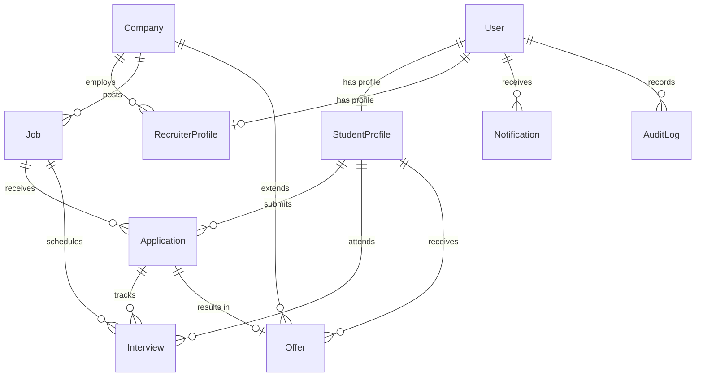

# PLACEMENTHUB — Campus Recruitment Management System (HACK-P410)
> **"One Platform. Every Opportunity."**

[](#)
[](#)
[](#)
[](#)
[](#)

---

## 📌 Executive Summary

**PLACEMENTHUB** is a full-stack, enterprise-grade Campus Recruitment SaaS application engineered for university placement departments, corporate talent acquisition partners, and graduating students. It completely centralizes the entire placement lifecycle:

$$\text{Company Verification} \longrightarrow \text{Drive Posting} \longrightarrow \text{Eligibility Verification} \longrightarrow \text{Applications} \longrightarrow \text{Interviews} \longrightarrow \text{Offers} \longrightarrow \text{Analytics}$$

Designed following clean enterprise software guidelines inspired by **Linear**, **Stripe Dashboard**, and **Vercel**, it prioritizes **deterministic eligibility calculation**, role-based security, real-time interview workflows, and audit-compliant placement reports.

---

## 🔑 Demo Personas & Credentials

For judging and evaluation, the database comes pre-seeded with 20 student profiles, 3 corporate partners, 6 recruitment drives, applications, interviews, offers, notifications, and audit logs.

| Role | Account Email | Password | Access Level |
| :--- | :--- | :--- | :--- |
| **Student** | `student@placementhub.demo` | `DemoPass123!` | Academic Profile, Browse Drives, Live Eligibility Check, Apply, Interview Calendar, Accept/Decline Offers |
| **Recruiter** | `recruiter@placementhub.demo` | `DemoPass123!` | Nexora Technologies Partner, Post Drives, Filter Candidates, Review Resumes, Schedule Interviews, Issue Offers |
| **Placement Admin** | `admin@placementhub.demo` | `DemoPass123!` | Institutional Analytics Dashboard, Student Registry, Company Verification, Drive Approvals, Audit Trail, CSV Exports |

> 💡 **Tip:** The Login Page includes **1-Click Instant Demo Portals** allowing judges to test each persona without manual typing.

---

## 🧠 Core Feature Highlights

### 1. Deterministic Intelligent Eligibility Engine (USP)
- **Zero AI Hallucinations**: Uses backend business logic evaluating institutional rules strictly before submission.
- **Criteria Evaluated**:
  1. Minimum CGPA threshold
  2. Maximum allowed active backlogs
  3. Eligible academic departments (with alias normalization e.g. CSE $\leftrightarrow$ Computer Science)
  4. Eligible graduation passing batches
  5. Application deadline timestamp check
  6. Mandatory verified PDF resume presence
  7. Drive publication status check
- **Detailed Explanation**: Students see an itemized checklist explaining exactly which requirements passed and which failed.
- **Resume Skill Alignment**: Transparent percentage match between student skills and recruiter requirements with matched and missing tags.

### 2. End-to-End Interview Scheduler
- Recruiters schedule **Technical**, **HR**, **Group Discussion**, **Online Assessment**, and **Final** rounds.
- Configurable dates, times, duration, online video links (Google Meet, Zoom) or on-campus venues, and custom instructions.
- Students receive automated in-app notifications with direct access to meeting links.

### 3. Offer & Placement Management
- Recruiters issue official placement letters with CTC, designation, location, and tentative joining dates.
- Students review and can **Accept** or **Decline** offers.
- System automatically distinguishes between **Placed Students** and **Total Offers** to prevent distorted placement metrics.

### 4. Admin Placement Analytics & Audit Trail
- Real database-driven Recharts visualizations:
  - Department-wise placement percentage comparison
  - Real-time candidate application status distribution
  - Company applicant-to-offer yield breakdown
- One-click downloadable CSV reports:
  - `students_report.csv`
  - `applications_report.csv`
  - `placement_offers_report.csv`
- Complete system-wide immutable Audit Trail capturing actor emails, roles, actions, and exact timestamps.

---

## 🚀 Quickstart & Running Locally

### 1. Start Backend API Server
```bash
cd server
npm run dev
# Server starts on http://localhost:5000
```

### 2. Start Frontend Web Client
```bash
cd client
npm run dev
# Client runs on http://localhost:5173
```

### 3. Run Automated Tests
```bash
cd server
npm test
# Executes vitest test suite for Eligibility Engine and status workflows (7/7 passing)
```

### 4. Re-seed Database (Optional)
```bash
cd server
npm run prisma:seed
```

---

## 🗄️ Database Architecture (Prisma ORM)



---

## 📂 Project Structure

```text
├── client/                     # Frontend Application (React + Vite + Tailwind)
│   ├── src/
│   │   ├── components/         # Reusable UI (EligibilityReportCard, Badges, Navbar, Sidebar)
│   │   ├── context/            # AuthContext with 1-click persona switchers
│   │   ├── layouts/            # DashboardLayout (Role-based layout wrapper)
│   │   ├── pages/
│   │   │   ├── public/         # Landing, Login, Student & Recruiter Registration
│   │   │   ├── student/        # Dashboard, Browse Jobs, Job Details, Applications, Interviews, Offers, Profile
│   │   │   ├── recruiter/      # Dashboard, Manage Drives, Create Drive, Applicant Management, Company Profile
│   │   │   └── admin/          # Analytics Dashboard, Student Directory, Company Verification, Drive Approvals, Audit Trail
│   │   ├── services/           # Axios API Client
│   │   └── types/              # Comprehensive TypeScript interfaces
│   └── vite.config.ts          # Vite configuration with proxy to port 5000
│
├── server/                     # Backend API (Node.js + Express + Prisma)
│   ├── prisma/
│   │   ├── schema.prisma       # Normalized schema
│   │   └── seed.ts             # 20 Students, 3 Companies, 6 Jobs, Interviews, Offers
│   ├── src/
│   │   ├── config/             # Database & environment configurations
│   │   ├── controllers/        # Auth, Student, Company, Job, Application, Interview, Offer, Admin
│   │   ├── middleware/         # JWT Auth, Role verification, Multer PDF upload
│   │   ├── routes/             # RESTful API route endpoints
│   │   ├── services/           # EligibilityService, AuditService, NotificationService
│   │   └── __tests__/          # Automated Vitest test suite
│   └── tsconfig.json
└── README.md
```

---

## 🏆 Hackathon Delivery Verification (HACK-P410)

- [x] **Product Name**: PLACEMENTHUB ("One Platform. Every Opportunity.")
- [x] **Smart Deterministic Eligibility Engine**: Implemented on backend with full breakdown report.
- [x] **Automated Tests**: 7/7 tests passing for eligibility verification & status transitions.
- [x] **Student, Recruiter, and Admin Dashboards**: Fully functioning with role isolation.
- [x] **End-to-End Recruitment Workflow**:
  - Admin verifies company
  - Recruiter posts job drive
  - Admin approves drive
  - Student checks deterministic eligibility and applies
  - Recruiter shortlists and schedules interview
  - Student receives in-app notifications
  - Recruiter extends placement offer
  - Student accepts offer
  - Real-time institutional analytics & CSV export update immediately!

